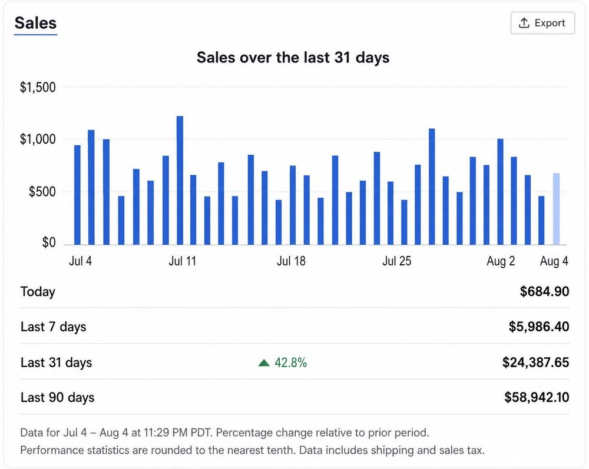
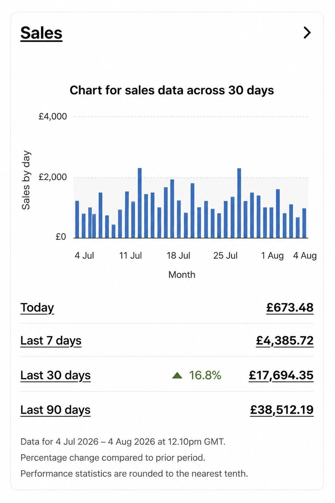
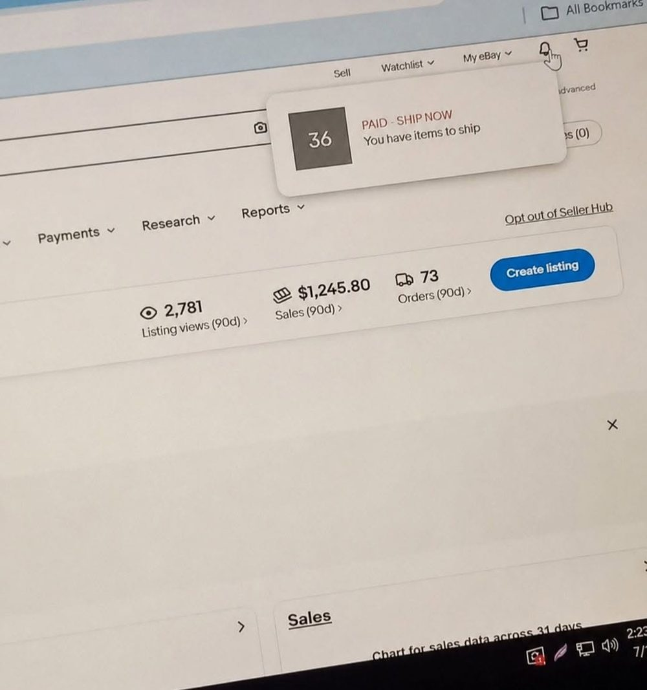
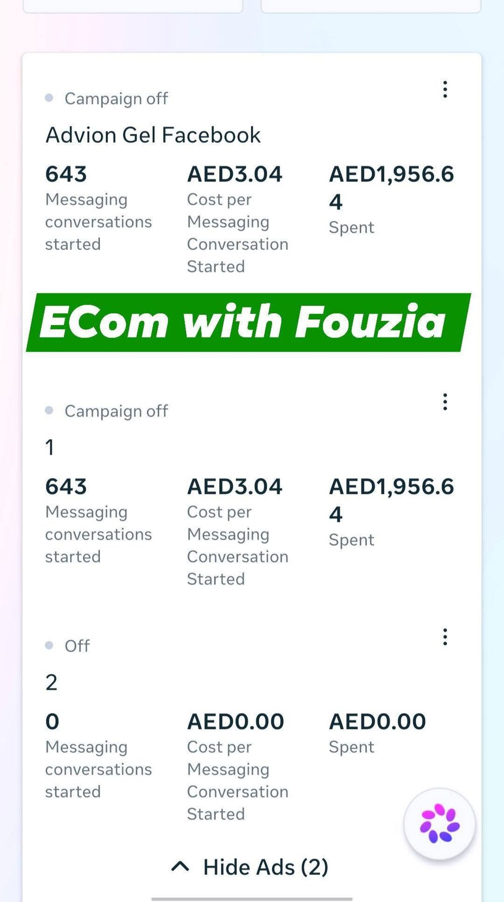
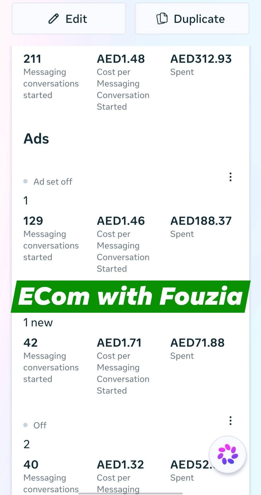
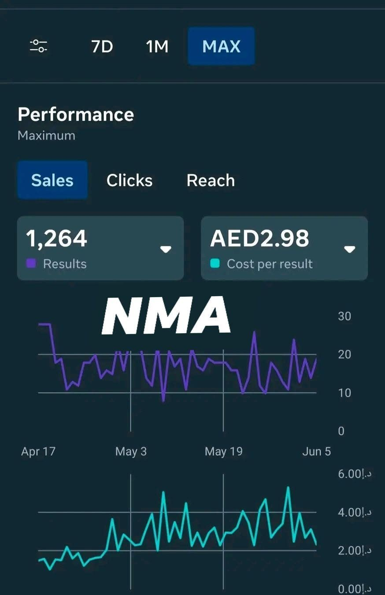
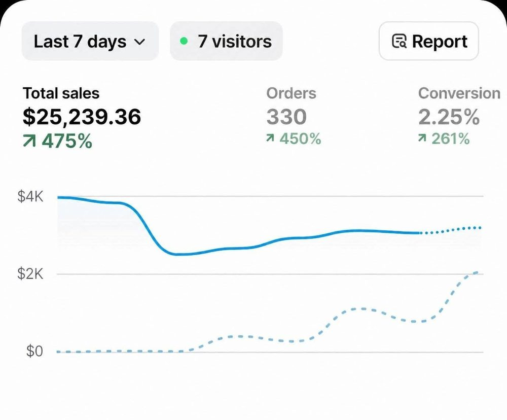

# Hi, I'm Fouzia Kousar 👋

Digital Marketing Specialist & E-commerce Consultant from Pakistan, freelancing since 2019.

**Founder of:**
- **Nova Marketing Agency** — Shopify development, Meta Ads management, eBay account management, digital marketing & e-commerce consultation
- **Nova Institute of Modern Technologies** (Chowk Azam, District Layyah) — practical digital skills training focused on women's economic empowerment

## What I do
- **Meta Ads** (Facebook/Instagram) — campaign planning, audience & lookalike targeting, retargeting, A/B testing, optimization
- **Shopify** — store development, theme customization, redesign, conversion rate optimization
- **eBay** — product research, listing SEO & optimization, dropshipping management for UK/international marketplaces
- **WordPress / WooCommerce** — website development
- **Social media marketing** & e-commerce consultation

## Selected Projects
Shopify stores I have designed and built (100+ live stores across fashion, fitness, pet and lifestyle niches):

- **Shanuwater** — https://shanuwater.com — Modern e-commerce · Premium layout & high-converting UI
- **Badmaash Beards** — https://badmaashbeards.com — Fashion / Lifestyle · Custom homepage sections & brand identity
- **Batch LDN** — https://batchldn.com — Strong CTA placement & conversion-focused design
- **Counter Coffee** — https://countercoffee.uk — Coffee brand · Engaging product pages & trust-building layout
- **Swishable** — https://getswishables.com — Clean branding, optimized PDPs & fast mobile UX
- **More projects:** https://uzmashad.com · https://dubaitrends.online · https://zyvensa.com · https://erpla.store · https://tomiwatches.pk

## eBay Results

Seller Hub results from eBay accounts under my management — product research, listing SEO and day-to-day account management (Jul–Aug 2026):

- **eBay.com (USD account):** $24,387.65 in sales in 31 days (▲ 42.8% vs prior period) · $58,942.10 in 90 days
- **eBay UK (GBP account):** £17,694.35 in sales in 30 days (▲ 16.8% vs prior period) · £38,512.19 in 90 days
- **Growing account:** 73 orders and $1,245.80 in sales in 90 days · 2,781 listing views

Video highlights: [Reel 1](https://www.facebook.com/share/r/1E5DUg6pyT/) · [Reel 2](https://www.facebook.com/share/r/1Ch6uTmTef/)

## Marketing Results

Meta Ads and e-commerce results from client campaigns under my management:

- **Advion Gel — Facebook messaging campaign (UAE):** 643 messaging conversations started at AED 3.04 per conversation · AED 1,956.64 spent
- **Messaging campaign (UAE):** 211 conversations started at AED 1.48 per conversation · AED 312.93 spent
- **Sales campaign (Apr–Jun):** 1,264 results at AED 2.98 cost per result
- **Shopify store growth (7 days):** $25,239.36 in sales (▲ 475%) · 330 orders (▲ 450%) · 2.25% conversion rate (▲ 261%)

Video highlights: [Reel 3](https://www.facebook.com/share/r/1HtYvv9zev/) · [Reel 4](https://www.facebook.com/share/r/1FNWxmonDv/) · [Reel 5](https://www.facebook.com/share/r/18TTnnE1nZ/)

## Markets I work with
UK · UAE · USA · Pakistan · Europe

## Currently
- Growing Nova Marketing Agency into a recognized international agency with a professional team and recurring clients
- Expanding Nova Institute's practical training programs for women and young people
